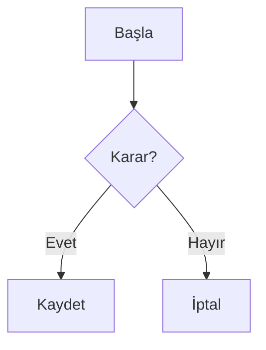

# Masaüstüne özgü bloklar

<!-- kalem:table color=blue widths=120,,200 -->
| Ad | Rol | Not |
| --- | --- | --- |
| Ayşe | Yazar | ilk taslak |
| Mehmet | Editör | gözden geçirme |



Satır içi matematik $e^{i\pi} + 1 = 0$ ve blok:

$$
\int_0^1 x^2 \, dx = \frac{1}{3}
$$

```math
a^2 + b^2 = c^2
```

Dipnotlu cümle[^not].

[^not]: Dipnot metni.

<span style="color:#c00">renkli metin</span> ve ==işaretli==.
